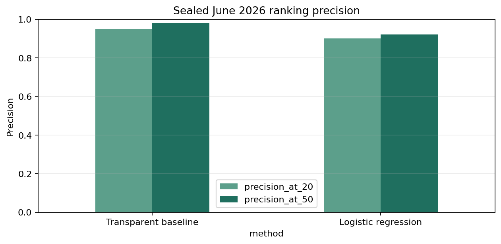

# Forecasting Search-Visibility Decline for Content Review Prioritization

**Lane:** Refresh / Content Opportunity Scoring  
**Release:** `flyrank_pseudonymized_warehouse_release_v20260703`  
**Status:** Verified warehouse run; sealed June 2026 evaluation complete  
**Random seed:** 42

## Abstract

This study asks whether historical page-level search signals can prioritize pages for content review. It uses the gated FlyRank warehouse release at the client-page-month grain, with March 2026 as the development validation period and June 2026 reserved as the sealed final outcome period. A transparent demand-and-deterioration rule is compared with regularized logistic regression on identical evaluation rows. On 93,048 sealed observations, logistic regression improved ROC AUC from 0.554 to 0.654 and average precision from 0.703 to 0.766, while the baseline remained better at Precision@20 (0.950 versus 0.900) and Precision@50 (0.980 versus 0.920). The resulting queue supports human content review with reason codes and action labels; it predicts observed next-month visibility decline, not the causal effect of refreshing content.

## 1. Introduction and decision problem

The decision is which existing pages an SEO specialist should inspect first when review capacity is limited. One row is a pseudonymized client-page snapshot. The system returns a ranked review queue; a reviewer checks freshness, search intent, coverage, and snippet quality before deciding whether any change is warranted.

The research question is: **Can pre-outcome page-level search signals rank pages that will experience a material next-month decline in observed search impressions more effectively than a transparent rule?**

A false positive wastes editorial effort, while a false negative can leave an observed decline unreviewed. The target is therefore a forecasting proxy for prioritization, not refresh uplift. A positive target means that next-month impressions were at least 20% below feature-month impressions.

## 2. Data source, release, windows, and exclusions

The analysis reads `fact_content_daily_performance` from the gated Hugging Face release through DuckDB. Daily facts are aggregated remotely to client-page-month snapshots; no raw warehouse export is committed. Eligible snapshots require at least 20 GSC-available days in both the feature and outcome months and at least 100 feature-month impressions.

The temporal design is fixed before the sealed evaluation:

| Role | Feature month | Outcome month | Use |
|---|---|---|---|
| Initial training | January 2026 | February 2026 | Model fitting |
| Initial training | February 2026 | March 2026 | Model fitting |
| Development validation | March 2026 | April 2026 | Method and implementation validation |
| Final refit addition | April 2026 | May 2026 | Added after the method was fixed |
| Sealed final test | May 2026 | June 2026 | One final evaluation |

June is not used to select features, thresholds, or models. Identifiers are used only for joins and overlap audits. Client names, domains, URLs, titles, raw queries, product decisions, credentials, and future-window fields are excluded from public artifacts and model features.

### Grain and release audit

The March partition contained 9,841,378 valid page-days with no repeated keys. The June partition contained 11,694,072 physical rows; 6,390 were exact repeated GSC observations, leaving 11,687,682 canonical page-days. There were no null-key rows and no same-key observations with conflicting GSC values in either audited partition. Exact repeated observations were de-duplicated before aggregation; conflicting observations would have stopped the pipeline.

CTR is calculated as total clicks divided by total impressions. Average position is impression-weighted as total `gsc_sum_position` divided by total impressions. Daily averages are never summed or averaged without weights.

## 3. Methodology

### Target

`target_future_decline = 1` when next-month impressions are no more than 80% of feature-month impressions. This is an observed future search-performance outcome. It does **not** measure whether a page was refreshed, whether a refresh was appropriate, or whether refreshing caused recovery.

### Features

The eight pre-outcome features are log impressions, CTR, impression-weighted average position, active days, click days, position-observed days, within-month impression momentum, and within-month click momentum. Future impressions, future ratios, the target, identifiers, and product decisions are excluded.

### Baseline and model

The transparent baseline combines observed demand, recent within-month deterioration, a reachable average-position band of 4–20, and low CTR. The ML method uses median imputation, standardization, and class-balanced regularized logistic regression with seed 42. The readable model was chosen to test whether a learned combination improves ranking without creating an opaque decision system.

### Validation and leakage controls

Development evaluation uses March features and April outcomes. After the method is fixed, the model is refit using outcomes only through May and evaluated once using May features and the sealed June outcome. Model and baseline are evaluated on exactly the same rows.

The primary operational metrics are Precision@20 and Precision@50. Average precision evaluates the ranking more broadly, ROC AUC evaluates pairwise discrimination, and the positive base rate provides essential context. Assertions enforce feature-before-outcome ordering, prevent target-derived fields from entering the feature matrix, and stop on conflicting page-day observations.

This is a time-aware split, not an unseen-client split. Development included 27 training clients, 37 test clients, and 25 overlapping clients. The final refit/test comparison included 47 training clients, 44 test clients, and 41 overlapping clients. Client IDs were never model features, but recurring-client patterns may still make temporal generalization easier than deployment to entirely new clients.

## 4. Results

### Development validation: March features → April outcome

The development set contained 88,941 observations, including 45,624 positives, for a 51.3% positive base rate.

| Method | Precision@20 | Precision@50 | Average precision | ROC AUC |
|---|---:|---:|---:|---:|
| Transparent baseline | 0.900 | 0.940 | 0.578 | 0.548 |
| Logistic regression | 0.700 | 0.640 | 0.591 | 0.615 |

The model improved broad discrimination during development but did not beat the rule at the very top of the queue. This pattern was retained rather than optimized away after inspecting the development results.

### Sealed final test: May features → June outcome

The sealed evaluation contained **93,048 observations**, including 59,620 positives. The positive base rate was **64.1%**, so precision must be interpreted against a relatively common outcome.

| Method | Base rate | Precision@20 | Precision@50 | Average precision | ROC AUC |
|---|---:|---:|---:|---:|---:|
| Transparent baseline | 0.641 | **0.950** | **0.980** | 0.703 | 0.554 |
| Logistic regression | 0.641 | 0.900 | 0.920 | **0.766** | **0.654** |

The logistic model improved ROC AUC by 0.100 and average precision by 0.063. This indicates better discrimination across the full set of eligible pages. However, the baseline was better at the operational shortlist cutoffs: five percentage points higher at Precision@20 and six percentage points higher at Precision@50.

The correct conclusion depends on review capacity. For a team reviewing only 20–50 pages, the transparent baseline is the stronger tested ranking. For broader triage, the model's higher average precision and ROC AUC show useful learned signal, but they do not justify replacing the baseline at the top of the queue.



*Figure 1. On the sealed June outcome, the transparent baseline produced the more precise top-20 and top-50 shortlists, despite the model's stronger whole-ranking metrics.*

## 5. Limitations and honest interpretation

The analysis forecasts changes in measured search visibility. It does not estimate Google's ranking algorithm, identify why impressions changed, or estimate the causal effect of editing a page. Search demand, seasonality, indexing changes, SERP features, query mix, site changes, and measurement coverage may drive the target.

The 20% decline threshold and minimum-volume rules are decision conventions. The panel is unbalanced, the final period has a high 64.1% positive rate, and findings from one release and time period may not transport to other sites or dates. Precision@20 and Precision@50 also have high sampling variability because they represent small shortlists.

The temporal split contains substantial client overlap. This matches an operational scenario involving later periods for known clients, but it does not demonstrate performance for unseen clients. A client-grouped temporal sensitivity analysis and prospective monitoring would strengthen external validity.

Most importantly, a predicted decline is not proof that a content refresh is needed or that a refresh would cause recovery. Causal refresh-effect claims require documented interventions and an experimental or credible quasi-experimental design.

## 6. Ranked content-action recommendations

The private runtime queue ranks all 93,048 eligible sealed-test observations. The aggregate reason-code distribution is public-safe:

| Primary reason code | Eligible observations | Human review prompt |
|---|---:|---|
| `REACHABLE_SEARCH_POSITION` | 45,566 | Check coverage and intent fit; position alone is not a refresh diagnosis. |
| `LOW_CTR_WITH_DEMAND` | 28,560 | Review snippet and intent alignment before changing body content. |
| `RECENT_VISIBILITY_DECAY` | 18,775 | Check freshness, relevance, demand shifts, and technical causes. |
| `MULTIVARIATE_DECLINE_RISK` | 147 | Inspect the combined evidence before selecting an action. |

These counts describe the eligible scored population, not a recommendation to update every page. Teams should work from the ranked head of the queue and retain the model probability, baseline score, reason code, action label, and limitation during human review.

Every recommendation carries the limitation that observed decline risk is not evidence a refresh will cause recovery. The queue must never automatically publish, delete, rewrite, or send client communications.

## 7. Reproducibility

The reproducible sources are the capstone notebook, `work/capstone_pipeline.py`, the unit tests, the aggregate JSON receipts, and this report. From a fresh clone with authorized access:

```powershell
python -m pip install -r requirements.txt
$env:HF_TOKEN = "<your gated read token>"
$env:RUN_WAREHOUSE = "1"
python -m jupyter nbconvert --to notebook --execute work/notebooks/capstone.ipynb --inplace --ExecutePreprocessor.timeout=3600
python -m unittest discover -s work -p "test_*.py" -v
```

The token is read only from the environment or a secure notebook secret. The random seed is 42. The row-level recommendation CSV remains gitignored; committed JSON and figures contain aggregate results only. The sealed warehouse should not be rerun merely to reproduce this write-up: the existing metric and audit receipts are the results provenance.

## 8. Acknowledgments and data credit

[Built on the FlyRank ML Internship dataset](https://flyrank.ai).
